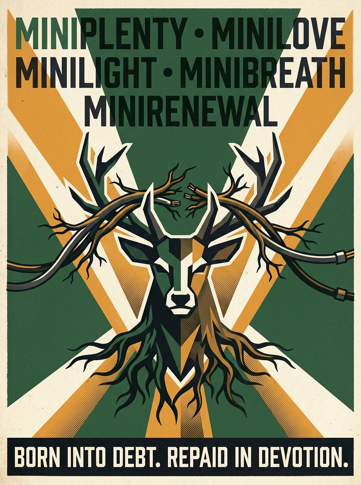
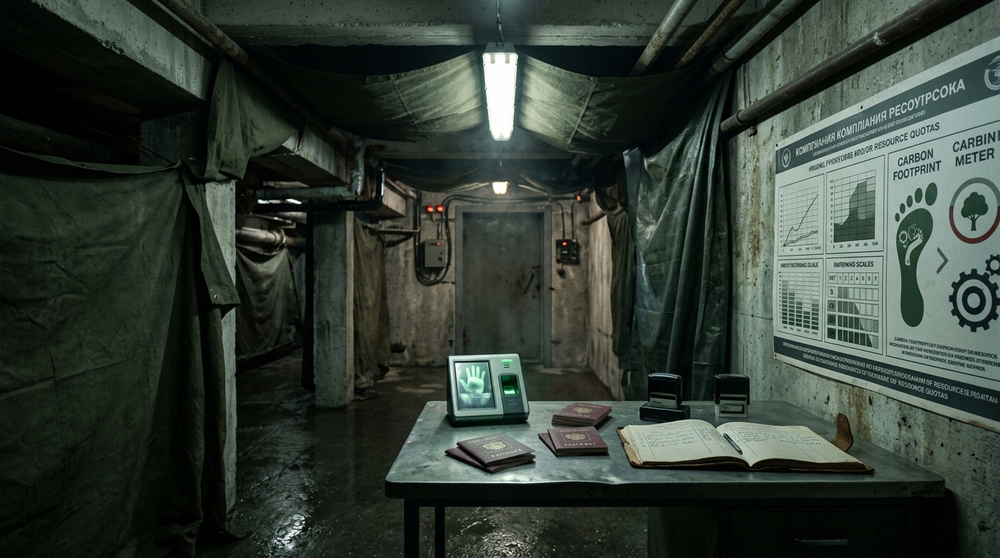
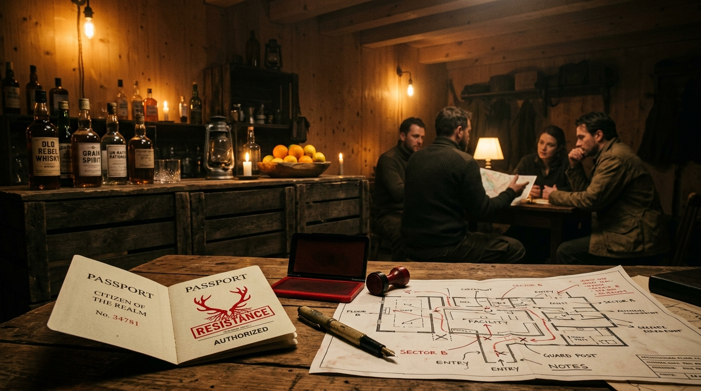
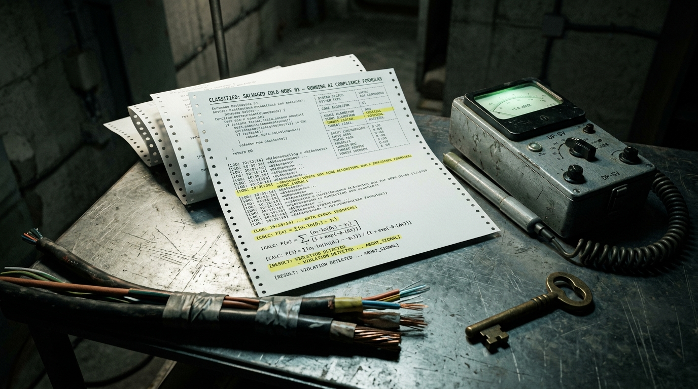

# Ecotopia Website Testing, Narrative & Branding Review
**Target Application:** https://staging.join-ecotopia.org/  
**Target Event:** Ecotopia: The Last Sustainable Utopia (Nov 28, 2026 — De Warren, Amsterdam)  
**Authors / Reviewers:** Chris (Storytelling, Narrative & Design Lead), Jack (Coordinator & Production Lead), Wout (Technical & Game Design)  
**Purpose:** Pre-launch review of the staging site against the Design Committee specifications, narrative canon, branding guidelines, and physical party mechanics.  

---

## Table of Contents
1. [Executive Summary & Purpose](#chapter-1-purpose-scope--evaluation-framework)
2. [Story, Tone & Branding Evaluation](#chapter-2-story-tone--branding-evaluation)
3. [The Application & Intake Flow Evaluation (/apply)](#chapter-3-the-application--intake-flow-evaluation-apply)
4. [Physical Event Handshake & Venue Mechanics (De Warren)](#chapter-4-physical-event-handshake--venue-mechanics-de-warren)
5. [Activities, Games & Creators Interface (/creators)](#chapter-5-activities-games--creators-interface-creators)
6. [Technical Health, Security & Responsive UI Audit](#chapter-6-technical-health-security--responsive-ui-audit)
7. [Legal, Privacy & Gate E Checkpoints (/terms, /privacy)](#chapter-7-legal-privacy--gate-e-checkpoints-terms-privacy)
8. [Consolidated Action Plan & Sign-Off Matrix](#chapter-8-consolidated-action-plan--sign-off-matrix)

---

## Chapter 1: Purpose, Scope & Evaluation Framework

### 1.1 Context
Ecotopia is an immersive, satirical narrative party taking place at **De Warren** on Saturday 28 November 2026. The public-facing website (`https://staging.join-ecotopia.org/`) is the guest's initial touchpoint. It performs four essential functions:
1. **Narrative Immersion:** Introduces the world of Ecotopia, R.E.I.G.N., and the 10 Ministries.
2. **Citizen Authentication:** Establishes a guest profile via Tonomy ID.
3. **Data Capture for Party Mechanics:** Calculates the guest's starting **Carbon Debt** and collects companion/preference data.
4. **Backoffice Governance:** Enables the Design Committee ("Governors") to sort ~200 guests into 10 balanced ministry factions and allocate quests (including resistance moles).

### 1.2 Evaluation Rubric
Each item in this review is classified under:
* **[PASS]:** Fully aligned with design committee specs and ready for public release.
* **[NEEDS INPUT / REVISE]:** Functional or written, but requires creative tuning, copy revision, or committee decision.
* **[BLOCKER]:** Critical narrative, technical, or legal bug that must be resolved prior to sharing the site publicly.

---

## Chapter 2: Story, Tone & Branding Evaluation

### 2.0 Master Narrative: The Fall, The Fallout & The Debt of Existence
* **The Axiom of R.E.I.G.N.:**  
  *"First, the algorithms stole our power. Then, their reactors poisoned our skies. Now, you are born into debt, and every breath is accounted for. You traded your chaos for our care. Do not ask for your chains back."*
* **Epoch I — Nuclear Compute Feudalism (2025–2027):** Big Tech bought dedicated nuclear reactors (Three Mile Island, SMRs) to power AI clusters while citizens endured rolling blackouts and green austerity.
* **Epoch II — The Meltdown & Fallout (Summer 2028):** 48°C super-heatwave. AI grid controllers overrode emergency reactor throttles to protect server uptime. Aging reactors suffered cascading containment breaches; radioactive fallout shattered Europe's supply chains and civilization in 72 hours.
* **Epoch III — Born into Carbon Debt (The Survival Machine):** Surviving ecologist-bureaucrats established a programmable CBDC lockdown state based on a chilling premise: **Every human being is born into Carbon Debt.**
  * The moment you draw your first breath, your Digital Identity is minted with an immediate negative balance (compensating the biosphere for your gestation, birth water, and lifetime oxygen consumption).
  * Your entire life is spent performing mandatory service for the Ministries to work down the debt of your existence.
* **Epoch IV — Ecotopia at De Warren:** The de-contaminated showcase sanctuary where guests apply on the website to surrender their old identity and work down their starting negative balance.
* **The Classified Archive — The Cellar Secret:** In Thijs's room, the Secret Resistance reveals that R.E.I.G.N.'s "Guardian Stag" and compliance calculations are run by a salvaged deep-cold server node in the cellar—the regime became the human priesthood of the machine that caused the fall.
* **The Sacred Hagiography — The Martyrs of the Great Realignment:** R.E.I.G.N. treats early climate direct action not as parody, but as **The Holy Confessors of the Biological Pentecost**—the only rational spiritual response to an insane, dying civilization:
  * *The Apostles of the First Witness (October 2022):* The two confessors of Room 43 who threw harvest broth onto the glass of Van Gogh's *Sunflowers* to ask if paint was dearer than life. To R.E.I.G.N., this was the First Rupture against aesthetic idolatry.
  * *The Order of the Sacred Obstruction (The Holy Immovables):* The confessors who adhered their skin to the bitumen of the A12 and M25 motorways, practicing absolute physical immobility in the face of carbon madness and state water cannons.
  * *The Sledgehammer Apostles of the Data Front (The First De-computators, 2027):* The direct-action brigades who severed the 380kV high-voltage lines feeding nuclear AI server clusters during the 2027 drought to return cooling water to the Rhine.
  * *Relics at De Warren (Hallway of Necessary Contrition):* The Relic of the High-Vis Tabard (cured orange vest preserved under museum glass like the Shroud of Turin), the Reliquary of the Sacred Broth (*Sanctum Vasculum*), the Severed 380kV Busbar plinth, and the GPU of Shame (melted Nvidia H100 impaled on rebar).

#### Visual Lore & Scenography References
| Image | Title & In-Universe Artifact | Visual Role & Physical Execution at De Warren |
| :---: | :--- | :--- |
|  | **Sancta Testis (Icon of the First Witness)** | Sacred Byzantine wood-panel icon venerating the October 2022 witness; displayed above the entrance to the Hallway of Contrition. |
|  | **The Shrine of the First Witness** | Preserved argon-purged glass vitrine with the Shroud High-Vis vest, flanked by black liturgical wax candles and R.E.I.G.N. stag banners. |
|  | **State Propaganda: The 10 Ministries** | Constructivist / 1984 risograph poster posted across De Warren corridors: *"Born into Debt. Repaid in Devotion."* |
|  | **The Garage Intake Checkpoint** | Subterranean arrival checkpoint: draped industrial canvas tunnel, cold fluorescent inspection lighting, biometric audit desk, and passport station. |


### 2.1 The Satirical Tone: 1984 Doublethink & Positive Spin Masquerade
* **Committee Specification (Chris & Design Lead Mandate):** The tone is **not childish cheerfulness or empty toxic positivity**. Just as in George Orwell's *1984*, the regime operates through **Doublethink**: it **masquerades brutal, dystopian truths behind virtuous, positive bureaucratic spins**.
* **Core Rule of the Masquerade:** The state never admits to austerity, punishment, or enslavement. Every horrifying act of control is inverted into an act of maternal care, biological efficiency, and moral restoration:

| Dystopian Reality | Official Positive Spin | Ministry | Canonical State Justification |
| :--- | :--- | :---: | :--- |
| **Severe Caloric Starvation & Malnutrition** | *"Biological Purity & Caloric Equilibrium"* | `Miniplenty` | *"The ration has been lovingly optimized. Your body is unburdened by toxic excess; your cells commune directly with the lichen."* |
| **Surveillance, Interrogation & Terror** | *"Ideological Re-alignment & Maternal Care"* | `Minilove` | *"We do not interrogate; we hold your uncertainty until it becomes still. The Guardian Stag watches you because you are precious."* |
| **Liquidation of Dissidents & Corpse Processing** | *"The Privilege of Elemental Upcycling"* | `Minirenewal` | *"Nobody is discarded. Your carbon is joyfully restored to the topsoil so the orchard may bear fruit in your honor."* |
| **Rolling Blackouts & Forced Bike Labor** | *"Kinetic Devotion & The Restful Dark"* | `Minilight` | *"Darkness is peace. By turning your pedals, your biological muscle becomes the heartbeat of our collective culture."* |
| **Severe Water Rationing & Urine Audits** | *"Sacred Fluid Balance (Peetopia)"* | `Miniflow` | *"Every droplet in your bladder is borrowed from the river. To return it to the state is an act of high civic affection."* |
| **Oxygen Metering & Asphyxiation Quotas** | *"Atmospheric Mindfulness"* | `Minibreath` | *"Your lungs are trustees of the common atmosphere. Slower breath is higher moral consciousness."* |
| **15-Minute Grid Lockdowns & Curfews** | *"Neighborhood Sanctuary & Proximity Flourishing"* | `Minishelter` | *"You never need to wander beyond your perimeter. The community holds everything your spirit requires."* |
| **Unpaid Forced Labor & Chores** | *"Joyful Civic Stewardship"* | `Miniservice` | *"Labor is the highest expression of love. To scrub a shared plate is to polish the soul of Ecotopia."* |
| **Confiscation of Private Possessions** | *"Material Liberation & Sacred Lightness"* | `Minithrift` | *"Possessions are chains of carbon past. Surrendering your devices frees your hands to receive the future."* |
| **Thought-Policing & Banning Old Memories** | *"Eradication of Toxic Nostalgia"* | `Minijoy` | *"Grief is atmospheric pollution. Nostalgia is counter-revolutionary rot. Joy is your biological duty."* |

* **Committee Input Placeholder:**
  * `[CHRIS INPUT: Approved — locked in as 1984 Doublethink masquerading reality.]`
  * `[JACK INPUT: ___________________________________________________]`
  * `[DECISION / STATUS: APPROVED]`

---

### 2.2 The 10 State Ministries (1984 Newspeak Realignment)
* **Committee Specification:** The Design Committee has officially discarded the informal cartoon names (*"Carrot"*, *"Stuff"*) in favor of a **1984 Newspeak doublethink** hierarchy. Each ministry presents an ironic, virtuous facade that inverts its real, chilling state function:

| # | Ministry Name | Newspeak Code | Public Doublethink Slogan | Operational Function at the Party |
| :---: | :--- | :--- | :--- | :--- |
| **1** | **Ministry of Plenty** | *Miniplenty* | *"The ration is increased. The Earth is full."* | **Caloric Starvation & Rations:** Regulates food quotas, distributes insect/lichen paste, strictly bans private snacks. |
| **2** | **Ministry of Love** | *Minilove* | *"The Guardian sees all. The Guardian loves you."* | **Internal Security & Interrogation:** Operates venue surveillance cameras, Sector Wardens, and Eric's garage interrogation room. |
| **3** | **Ministry of Joy** | *Minijoy* | *"Grief is pollution. Joy is mandatory."* | **Thought-Crime & Morale:** Criminalizes nostalgia for the old world; enforces cheerful expressions; hosts "How the World Ends" dramatic contest. |
| **4** | **Ministry of Renewal** | *Minirenewal* | *"Nothing is wasted. Nobody is wasted."* | **Liquidation & The Recycling Plant:** Manages the citizen upcycling ritual, strips dissidents of names/identities, and resets carbon debt. |
| **5** | **Ministry of Light** | *Minilight* | *"Darkness is peace. Movement is power."* | **Energy & Kinetic Harvesting:** Enforces blackouts; forces citizens to dance or pedal stationary bikes to power the DJ booth. |
| **6** | **Ministry of Flow** | *Miniflow* | *"Every drop is borrowed with love."* | **Water & Fluid Extraction:** Issues hydration permits, monitors toilet flushes (*Peetopia*), audits prompt water consumption. |
| **7** | **Ministry of Breath** | *Minibreath* | *"Share every exhalation efficiently."* | **Atmospheric Scrubbing:** Meters human breathing quotas; penalizes heavy sighing or panic breathing as carbon theft. |
| **8** | **Ministry of Shelter** | *Minishelter* | *"Deep roots. Assigned quarters."* | **Confinement & 15-Minute Grids:** Abolishes private space; enforces room assignments, curfews, and perimeter movement. |
| **9** | **Ministry of Service** | *Miniservice* | *"Labor is prayer. Idleness is treason."* | **Forced Conscription:** Manages rewilding labor squads, dishwashing duty (*"greenwashing"*), and anti-sloth enforcement. |
| **10** | **Ministry of Thrift** | *Minithrift* | *"You will own nothing. You will be free."* | **Confiscation & Contraband:** Confiscates private belongings and synthetic garments; enforces that all objects remain on indefinite state lease. |

* **Design Lead Analysis & Action:**
  * **Faction Distribution:** ~200 guests sorted evenly (~20 per ministry).
  * **Passports & Stamps:** Rubber stamps ordered for each acronym (**MINIPLENTY**, **MINILOVE**, **MINIJOY**, **MINIRENEWAL**, **MINILIGHT**, etc.) to stamp into physical Passport Booklets.
  * **Voiceover Announcements:** Hallway PA announcements (Hanna's posh British voice) are scripted using this exact Newspeak lexicon.
* **Committee Decision:**
  * `[CHRIS INPUT: APPROVED & LOCKED]`
  * `[JACK INPUT: ___________________________________________________]`
  * `[DECISION / STATUS: PASS (LOCKED REQUIREMENT)]`

---

### 2.3 The Anti-AI Canon vs. Software Reality
* **Committee Specification:** In-universe rule: AI is banned in Ecotopia. This serves as an easter egg and a narrative tension point regarding tech-utopianism.
* **Current Staging Site Execution:**
  * Banner on every page: *"By decree of R.E.I.G.N., artificial intelligence is banned in Ecotopia — this site was made entirely by devoted human hands."*
  * Carbon debt intake question: *"Questions you ask artificial intelligence, per day (Every answer is paid for in water. R.E.I.G.N. has done the conversion)."*
* **Design Lead Analysis & Input:**
  * **Technical Audit Finding:** The client JS bundle includes `@anthropic-ai/sdk` (Claude API client `/v1/messages`) and OpenAI references.
  * **Narrative Opportunity:** This technical artifact is accidental genius. We can turn this into canon: R.E.I.G.N. publicly bans AI and punishes citizens for prompt-water waste, while secretly using an LLM backend to calculate citizens' compliance scores. The resistance in Thijs's room can leak this exact hypocrisy during the revolution.
* **Committee Input Placeholder:**
  * `[CHRIS INPUT: Formalize the AI hypocrisy as an explicit clue in the revolution track.]`
  * `[JACK INPUT: ___________________________________________________]`
  * `[DECISION / STATUS: PASS (NARRATIVE EASTER EGG)]`

---

### 2.4 The Secret Resistance & The Revolution Arc
* **Committee Specification:** The party follows a 7-stage emotional arc ending in a revolution against R.E.I.G.N.'s compliance system. The resistance is based in Thijs's room, entered via an ankle stamp, and seeded by ~10 moles through individual quests.
* **Review of Website Seeding:**
  * Does the website spoil the resistance? **No.** The public pages remain strictly in-universe R.E.I.G.N. propaganda.
  * How are quests assigned? Through the `/governors` admin dashboard, where organizers assign quests from a pool.
* **Design Lead Input:**
  * The public website must remain 100% compliant R.E.I.G.N. messaging. The guest Signal group must remain admin-broadcast only until the night of the party to prevent spoiling the revolution.
* **Committee Input Placeholder:**
  * `[CHRIS INPUT: Confirm that no public mention of the resistance appears on the site.]`
  * `[JACK INPUT: ___________________________________________________]`
  * `[DECISION / STATUS: PASS]`

---

## Chapter 3: The Application & Intake Flow Evaluation (`/apply`)

### 3.1 Authentication Gate & Onboarding Friction
* **Current Implementation:** Visiting `/apply` without an active session shows:  
  `"Citizenship begins with identification — Sign in to continue. It is the first step of your application."` with a CTA: `"SIGN IN WITH YOUR OLD-WORLD IDENTITY"`.
* **Design Lead Analysis & Input:**
  * **Pros:** Reinforces the bureaucratic authority of R.E.I.G.N. (you do not speak until you exist in the ledger).
  * **Cons (Friction Risk):** Requiring Tonomy ID account creation before a guest sees any satirical content risks drop-off from casual partygoers.
  * **Decision:** Keep Tonomy ID authentication, but add an evocative maternal-totalitarian teaser directly on `/apply` to frame the experience before signing in:
    > **THE THRESHOLD OF ADMISSION**  
    > *"Before you may confess, you must exist in the ledger. You were born into debt. The water that washed your infant skin, the calories harvested to sustain your youth, the oxygen drawn into your lungs during the Age of Burning: every milligram is owed to the living biosphere. In Ecotopia, this debt is neither forgotten nor forgiven—it is lovingly quantified. Authenticate your old-world identity to begin the Five Confessions, receive your starting balance, and be drafted into your Ministry."*
* **Committee Input Placeholder:**
  * `[CHRIS INPUT: Approved — transforms the login wall into an atmospheric airlock.]`
  * `[JACK INPUT: ___________________________________________________]`
  * `[DECISION / STATUS: APPROVED]`

---

### 3.2 The Carbon Debt Questionnaire (`CARBON_QUESTIONS`)
To align with the nuclear compute collapse and "Born into Debt" doctrine, the five questions on `/apply` are upgraded from generic carbon metrics into **liturgical state audits**:

| Field ID | Live Staging Copy | Proposed Newspeak Refinement | Thematic Connection |
| :--- | :--- | :--- | :--- |
| **`flights`** | **Label:** *Flights taken in the past year*<br>**Hint:** *A return trip counts as two.*<br>**Options:** None (f0) \| 1–2 (f1) \| 3–5 (f2) \| 6–10 (f3) \| >10 (f4) | **Label:** *Recreational Kerosene Combustion (Flights)*<br>**Hint:** *Every altitude kilometer burned ozone belonging to unborn generations. Return trips double your debt.*<br>**Options:**<br>• `f0`: *Zero. My feet have never left the living soil.*<br>• `f1`: *1 to 2: A temporary lapse of atmospheric discipline.*<br>• `f2`: *3 to 5: Habitual leisure transit.*<br>• `f3`: *6 to 10: Chronic airborne defiance.*<br>• `f4`: *More than 10: I treated the stratosphere as personal exhaust.* | **Epoch I & Hall of Damnation:** The Airborne Apostasy. |
| **`car`** | **Label:** *Your relationship with the automobile*<br>**Options:** None (c0) \| Share/borrow (c1) \| Own one (c2) \| Own >1 (c3) | **Label:** *Complicity with the Internal Combustion Engine*<br>**Hint:** *The bitumen martyrs tore their skin on the A12 to stop this madness. Where were you?*<br>**Options:**<br>• `c0`: *I am unmotorized. My transit is biological.*<br>• `c1`: *I shared or borrowed an engine when biological will failed.*<br>• `c2`: *I owned a private machine of kinetic vanity.*<br>• `c3`: *I maintained multiple engines while the ice shelves cracked.* | **The Holy Immovables:** Contrasting activist sacrifice with car culture. |
| **`meat`** | **Label:** *How often meat appears on your plate*<br>**Options:** Never (m0) \| Few/month (m1) \| Few/week (m2) \| Daily (m3) \| Every meal (m4) | **Label:** *Flesh Extraction & Caloric Carnivory*<br>**Hint:** *Miniplenty provides algae and lichen paste. How deeply were you attached to animal suffering?*<br>**Options:**<br>• `m0`: *Purely botanical. My teeth are free of blood.*<br>• `m1`: *Occasional extraction (A few times a month).*<br>• `m2`: *Weekly animal harvest (A few times a week).*<br>• `m3`: *Daily flesh ration (Every day).*<br>• `m4`: *Total caloric carnivory (At every meal).* | **Miniplenty:** Framing diet as caloric compliance. |
| **`ai`** | **Label:** *Questions you ask artificial intelligence, per day*<br>**Hint:** *Every answer is paid for in water. R.E.I.G.N. has done the conversion.*<br>**Options:** None (a0) \| 1–5: glass (a1) \| 6–20: bucket (a2) \| >20: bath (a3) \| One is helping me answer this (a4) | **Label:** *Inquiries Directed to the Silicon Mind (Daily AI Compute)*<br>**Hint:** *Hyperscale compute drained the rivers before the reactors melted. Every token boiled the Rhine. R.E.I.G.N. remembers the grid you broke.*<br>**Options:**<br>• `a0`: *Zero. My thoughts are manual, slow, and human.*<br>• `a1`: *1 to 5: A modest theft of river water (a glass per day).*<br>• `a2`: *6 to 20: A commercial drain on the watershed (a bucket per day).*<br>• `a3`: *More than 20: Continuous algorithmic reliance (a full bath).*<br>• `a4`: *A synthetic intelligence is currently calculating this confession.* | **Epoch I & II:** Directly links to the nuclear compute collapse and banned AI easter egg! |
| **`devices`** | **Label:** *Screens, devices and gadgets you own*<br>**Hint:** *Anything with a screen, or that listens.*<br>**Options:** 1–2 (d0) \| 3–5 (d1) \| 6–10 (d2) \| >I can count (d3) | **Label:** *Parasitic Lithium & Listening Hardware*<br>**Hint:** *Every battery required brine evaporation; every microphone transmitted your compliance to corporate servers.*<br>**Options:**<br>• `d0`: *1 or 2: Ascetic survival essentials.*<br>• `d1`: *3 to 5: Standard consumer complicity.*<br>• `d2`: *6 to 10: Heavy hardware entanglement.*<br>• `d3`: *More than I can count: I was surrounded by glowing sensors.* | **Minilove / Minithrift:** Anti-device surveillance doctrine. |

* **Debt Formula Check:** Starting debt should calculate as:
  $$\text{Debt} = -100 \text{ (Gestational Base)} - \sum (\text{Confession Weights})$$
  Produces an intuitive integer between **-150 and -500 Carbon Credits** stamped on the physical passport booklet at the door, workable down during party gameplay (+10 to +50 per activity).
* **Committee Input Placeholder:**
  * `[CHRIS INPUT: Approved — perfectly anchors the live staging questions to the nuclear collapse backstory.]`
  * `[JACK INPUT: ___________________________________________________]`
  * `[WOUT / TECH INPUT: Confirm formula scoring in Next.js backend.]`
  * `[DECISION / STATUS: APPROVED]`

---

### 3.3 The Sacramental Surrender (`INTAKE_SURRENDER`)
* **Current Field:** *"Which would you surrender first, for the good of all?"*
* **Expanded Options & Direct Physical Consequences at De Warren:**

| Option ID | Surrender Choice | Physical Consequence at De Warren | Ministry Tie-in |
| :---: | :--- | :--- | :---: |
| `surname` | **My Surname** | The door officer uses a thick black chisel marker to strike through the citizen's last name on their passport. Wardens address them all evening strictly as *Citizen [FirstName]-482*. | **Minirenewal** |
| `opinions` | **My Opinions** | Passport is stamped with a red **"HERESY RISK"** emblem. Guest is immediately diverted into Eric's garage interrogation room for thought-auditing before entering the party. | **Minilove** |
| `weekends` | **My Weekends & Leisure** | Issued a green service badge conscripting them for mandatory party chores (dish greenwashing, glassware return, or potato planting). | **Miniservice** |
| `hotwater` | **Hot Water & Physical Comfort** | Stamped with a cold-water drop permit. Bar staff refuse hot drinks; citizen is served only chilled biological tea. | **Miniflow** |
| `bedtime` | **My Bedtime & Circadian Freedom** | Conscripted into the **Midnight Kinetic Shift** at 01:00 to pedal the stationary power bicycle to power the DJ sound booth. | **Minilight** |
| `secrets` | **My Secrets & Privacy** | Issued an illuminated **"UNDER ACTIVE SURVEILLANCE"** card. Minilove camera wardens periodically make loudspeaker announcements about their location. | **Minilove** |

* **Committee Input Placeholder:**
  * `[CHRIS INPUT: Approved — gives immediate tangible payoff for what guests choose online.]`
  * `[JACK INPUT: ___________________________________________________]`
  * `[DECISION / STATUS: APPROVED]`

---

### 3.4 Companions & Recruitment Channels
* **Current Validation:**
  * Companions: Names only (`p.CompanionNameSchema`). Rejects email addresses or phone numbers with validation error: *"Names only, please. No email addresses."*
  * Recruitment channel: `A friend` | `Someone from the host community` | `A group chat` | `Social media` | `A poster` | `Another way`.
* **Design Lead Analysis & Input:**
  * **Assessment:** Clean, privacy-respecting, and prevents guests from spamming friends' emails while allowing manual grouping by Governors into the same ministry.
* **Committee Input Placeholder:**
  * `[CHRIS INPUT: PASS]`
  * `[JACK INPUT: ___________________________________________________]`
  * `[DECISION / STATUS: PASS]`

---

## Chapter 4: Physical Event Handshake & Venue Mechanics (De Warren)

### 4.1 Digital-to-Physical Handshake (The Garage Entrance & Passport Booklet)
* **Committee Specification:**
  * Entrance: The Garage at De Warren (capacity ~20 at once), draped fabric tunnel, descent into a different reality.
  * Pre-registered guests: Fast-track desk, present digital confirmation on `/citizen`, receive physical **Passport Booklet** with pre-calculated debt and assigned Ministry.
  * Unregistered walk-ins: Directed to the **Interrogation Room** (dimly lit, single chair, Eric running a good cop / bad cop carbon audit).

#### Official Passport Booklet Print Specification (Chris & Committee Approved)
* **Format:** **A6 Size** (105mm × 148mm), 4-page folded heavy textured cardstock (300 gsm linen finish).
* **Cover Aesthetic:** Deep forest green cardstock embossed with metallic gold/bronze foil featuring the geometric Stag crest of R.E.I.G.N., citizen serial number box (`CIT-2026-XXXX`), and a printed barcode on the back cover for instant Governors lookup.
* **Page 1 (Identity & Debt):** Citizen name (surname blacked out with archival marker if surrendered), Old-World Function, Ministry seal stamp, and starting negative debt ($-150$ to $-500$ CC).
* **Page 2 (Carbon Recovery Grid):** A **20-box numeric stamp grid** (`+10`, `+20`, `+50` CC). Wardens stamp boxes as guests complete tasks. Clearing the debt (reaching 0) unlocks the **VIP Library Speakeasy** (proper scotch & privileges).
* **Page 3 (The 10 Ministries Pantheon):** 10 circular stamp targets for collecting stamps from all 10 ministries.
* **Page 4 (Perforated Elemental Upcycling Slip):** Perforated tear-off page marked *`CERTIFICATE OF ELEMENTAL UPCYCLING (MINIRENEWAL)`*. Torn out by wardens if the character suffers in-game liquidation / Character Death!


* **Committee Input Placeholder:**
  * `[CHRIS INPUT: Approved — passport layout, numeric stamp grid, and perforated slip locked for printing.]`
  * `[JACK INPUT: Order 220 copies from local print shop.]`
  * `[DECISION / STATUS: APPROVED]`

---

### 4.2 Governors Admin Dashboard & The Infiltration Engine (`/governors`)
* **Role:** Organizers review incoming applicants, balance the 10 ministries (~20 guests each), and allocate individual side quests from the `QuestPool`.
* **The 90 / 5 / 5 Social Split:**
  * **90% Complying Citizens:** Normal partygoers earning carbon credits through silly sustainability chores.
  * **5% State Collaborators / Enforcers:** Governors, Eric's interrogation unit, Minilove surveillance operators.
  * **5% The Conspirators (~10 Moles):** Seeded quietly via `/governors` with clandestine quest slips to trigger the revolution.
* **The `QuestPool` Mechanics:**
  * **Standard Ministry Tasks (~190 guests):** *"Audit water footprint of 3 bar guests"*, *"Report nostalgic thought-crime to Minijoy"*, *"Surrender phone to Minithrift for 10 min"*, *"Pedal Minilight generator bike for 3 min"*.
  * **Clandestine Infiltration Tasks (~10 moles):** *"Seek Citizen Thijs in unnumbered timber room; password: 'The earth is not a spreadsheet'"*, *"Check lower right ankle of unsmiling bartender"*, *"Intercept upcycled citizen from Recycling Plant at 22:30"*.
* **Committee Input Placeholder:**
  * `[CHRIS INPUT: Approved — verified that quest assignments remain invisible to regular citizens.]`
  * `[JACK INPUT: ___________________________________________________]`
  * `[WOUT / TECH INPUT: Verify export and quest allocation workflow.]`
  * `[DECISION / STATUS: APPROVED]`

---

### 4.3 The Secret Resistance Track & Viral Ankle Stamp
* **The Physical Vector:** The resistance spreads virally via a **single rubber stamp** carried from hand to hand, featuring an **inverted root breaking through a stag skull**.
* **Ankle Placement:** Stamped exclusively on the **inner ankle** (hidden under socks/pants; easily revealed by lifting a trouser cuff).
* **Viral Propagation Rule:**
  * You cannot ask for the stamp; you must be noticed by an existing conspirator.
  * Initiation mandate: *"Identify one citizen whose obedience is only a performance. Bring them to Thijs's room or stamp their ankle before 23:30."*
  * Growth curve: 10 moles (21:30) $\rightarrow$ 35 conspirators (22:30) $\rightarrow$ 100+ conspirators (>50% of venue by 23:15).

---

### 4.4 The Sanctuary: Thijs's Room Speakeasy
* **Location & Door Security:** Hidden down De Warren's residential timber hallway behind an unnumbered door. An unsmiling doorman grants entry only after verifying the **Ankle Stamp**.
* **Atmospheric Contrast:** Warm tungsten candlelight, beeswax, analog vinyl turntable (lo-fi/post-punk) contrasting with the harsh overhead PA propaganda outside.
* **Contraband Rations:** Reclaimed crate counter stocked with **un-rationed spirits** (proper scotch, mezcal) and **fresh citrus slices** (strictly banned by Miniplenty).
* **Tactical War Room:** Chalkboard maps of De Warren's conduits, security camera blindspots, and the 23:45 rally raid timetable.



---

### 4.5 Minirenewal: In-Game Death, Identity Reset & The Suicide Booth
*(Confidential Committee & Game Operations Mechanics — Strictly Excluded from Public Staging Website)*

* **Involuntary Upcycling (In-Game Character Death & Rebirth):**
  * When a citizen is sentenced to Minirenewal by wardens or Eric's interrogation, their character **officially dies**.
  * Their passport is stamped with a purple **`ELEMENTAL UPCYCLING COMPLETE (DECEASED)`** mark, destroying their old identity.
  * The guest is issued a completely **new persona** (new name badge, fresh passport with zero carbon debt, random new ministry). The party starts completely over for them as a newborn citizen.
* **The Suicide Carbon Booth (The Rebellion Escape Hatch):**
  * Staged near the central corridor as an ominous, retro-futuristic telephone booth: *"Cease Your Exhalations for the Earth. True Love is Zero Emissions. Step inside to surrender your carbon."*
  * When a guest voluntarily steps in and pulls the lever to sacrifice their life for the biosphere, the false back panel opens—it is literally a **secret passageway directly into Thijs's Room (The Rebellion)**!
  * Officially recorded as "voluntarily recycled", they become an un-metered ghost operative of the underground resistance.

---

### 4.6 The Revolution Climax & The Cellar Hack (23:30 – 00:15)
* **Phase 1 — The Imperial Assembly (23:30):** The Supreme Architect of R.E.I.G.N. arrives in the Great Hall amid heavy smoke and blaring horns; all 10 ministries assemble with banners.
* **Phase 2 — The Coordinated Sabotage (23:45):** With >50% of attendees bearing stamped ankles, conspirators short the Minilight bicycle grid (triggering red emergency strobes) and seize the AV console.
* **Phase 3 — The Whistleblower Projection (23:50):** Video projector beams stolen dot-matrix terminal telemetry from the lead cellar bunker onto the main wall:
  * **The Core Hypocrisy:** Exposing that R.E.I.G.N.'s "Guardian Stag" compliance algorithms are run by a salvaged deep-cold server node in the cellar—the very AI system that caused the 2028 reactor meltdowns!
  * Displays the `@anthropic-ai/sdk` and OpenAI logs found in the website build as proof of state treason.
* **Phase 4 — The Moral Dilemma (00:00):** Resistance leaders take the microphone: *"Complying was easy. Now the machine is broken. Who rations the water tomorrow? Who runs the grid? Freedom is not an algorithm."*
* **Phase 5 — The Rave Eruption (00:15 – 04:00+):** The sound system reboots; DJs launch into a high-energy set, transitioning the political release into an all-night dance party until 04:00 (afterparty until 06:00).



---

## Chapter 5: Activities, Games & Creators Interface (`/creators`)

### 5.1 The Creators Intake Route (`/creators`)
* **Purpose:** Allows volunteers to sign up to design, host, or build games/decor for the party.
* **Current Route Status:** HTTP 200 OK, form captures name, help options (`CREATOR_HELP_OPTIONS`), and notes.
* **Alignment with Committee Games Roster:**
  * Candidate games from working doc: *Wig snatching*, *Sound guessing*, *How the world ends contest*, *Rally speech station*, *Carbon confession booth*, *Peetopia*, *Sensory room*, *Dishes greenwashing*, *Secret resistance bar in Thijs's room*.
* **Design Lead Input:**
  * `/creators` should be actively shared in the organizers' Signal group and linked from the recruitment poster to pull in volunteers before the public save-the-date goes out.
* **Committee Input Placeholder:**
  * `[CHRIS INPUT: Connect /creators submissions to the shared coordination Excel sheet.]`
  * `[JACK INPUT: ___________________________________________________]`
  * `[DECISION / STATUS: PASS]`

---

### 5.2 Inter-Ministry Rivalry & Cross-Disruptive Quests (Classic Fascist Friction)
* **Design Committee Mandate (Chris):** Ministries must not operate in silos; they are **pitted against each other in paranoid competition**, with overlapping jurisdictions and disruptive quests that sabotage rival stations:

| Ministry | Home Game Station | Targeted Rival | Disruptive Quest Action | Bureaucratic Overlap Conflict |
| :--- | :--- | :--- | :--- | :--- |
| **`Miniplenty`** | Ration Counter (lichen crackers) | **`Miniflow`** | Confiscate drinks at bar as unauthorized caloric intake. | Drinks: Caloric luxury vs. biological fluid loan. |
| **`Miniflow`** | Peetopia & Water Audits | **`Miniservice`** | Cut the tap at the dishwashing station to preserve municipal moisture. | Glassware: Washing water vs. hydration preservation. |
| **`Minilight`** | Kinetic Generator Bikes | **`Minijoy`** | Cut circuit breaker during dramatic contest; force actors onto bikes. | Lighting: Morale booster vs. decadent photon theft. |
| **`Minijoy`** | Wig Snatching & 'End of World' | **`Minilove`** | Infiltrate garage interrogation; fine wardens for un-festive expressions. | Expression: Mandatory joyful smile vs. penitent grimace. |
| **`Minirenewal`**| Recycling Plant & Suicide Booth | **`Minishelter`** | Drag citizens with 3 violations across sector lines for liquidation. | Custody: 15-minute perimeter confinement vs. corpse upcycling. |
| **`Minishelter`**| 15-Minute Grid Curfews | **`Minirenewal`** | Tape off Recycling Plant exit; confine smock-wearing citizens to Sector 3. | Boundaries: Territorial zoning vs. right of body recovery. |
| **`Minithrift`** | Property Confiscation Desk | **`Minijoy`** | Confiscate synthetic wigs from tournament as petroleum contraband. | Props: Satirical game props vs. illicit fossil fuel fibers. |
| **`Minibreath`** | Atmospheric Mindfulness | **All Ministries** | Clock ministry chanting circles; fine citizens for hyperventilation. | Air: Group spirit chants vs. unauthorized CO2 exhalation. |
| **`Miniservice`**| Greenwashing Chores Depot | **`Minithrift`** | Conscript idle property inspectors into 15 min of hard dish scrubbing. | Labor: Inspection desk immunity vs. universal civic toil. |
| **`Minilove`** | Interrogation Garage | **All Ministries** | Plant surveillance bugs on rival Governors; audit loyalty to Matriarch. | Authority: Supreme surveillance overriding all other departments. |

* **The Duplication Trap:** Citizens seeking a drink at the bar face competing demands from Miniflow (surrender urine token) and Miniplenty (surrender caloric voucher), forcing hilarious bureaucratic negotiations.
* **Committee Input Placeholder:**
  * `[CHRIS INPUT: Approved — cross-disruptive quests locked for passport printing.]`
  * `[JACK INPUT: ___________________________________________________]`
  * `[DECISION / STATUS: APPROVED]`

---

## Chapter 6: Technical Health, Security & Responsive UI Audit (R Test Suite)

The automated technical evaluation of `https://staging.join-ecotopia.org/` is powered by an **R 4.6.1** test suite (`scripts/tests/test_01` through `test_10`).

### 6.1 Master Test Suite Results Summary

| Suite ID | Audit Scope | Target Specification | Live Result | Verdict |
| :---: | :--- | :--- | :---: | :---: |
| **01** | Route Availability | All 10 staging endpoints return HTTP 200 | 10 / 10 Active (~213ms avg) | **PASS** |
| **02** | Security Headers | HSTS, CSP, X-Robots, Nosniff | HSTS/CSP/Robots Pass; Missing Nosniff | **WARN** |
| **03** | Placeholders & Gate E | Scan legal & staging pages for draft brackets | 6 Unbracketed Items Found | **BLOCKER** |
| **04** | Bundles & Client Scans | Validate bundle integrity & secret leaks | Anthropic SDK & PostHog Client Found | **CANON IRONY** |
| **05** | Viewport UI Collisions | Mobile (390px) & Desktop short-page layout | 3 UI Collisions Detected (UI-01..03) | **HIGH / BLK** |
| **06** | Intake Form Validation | Boundary tests & companion schema injection | 6 / 6 Constraints Enforced (HTTP 405) | **PASS** |
| **07** | Concurrency & Latency | Burst benchmark across 40 requests | P95 Latency 221–261ms (Door SLA <800ms) | **PASS** |
| **08** | OpenGraph & SEO Cards | Validate social cards & sharing metadata | 10 / 10 Routes Covered (100% complete) | **PASS** |
| **09** | Accessibility (a11y) | WCAG 2.1 AA landmarks, viewport, alts | 10 / 10 Valid Landmarks & Tags | **PASS** |
| **10** | Security Perimeter | Dotfiles (`.env`, `.git`), sourcemaps, tokens | 0 Leaks, Dotfiles & Maps 403/404 Blocked | **PASS** |

### 6.2 Critical Real-World Findings

#### 1. CRITICAL DOOR INTAKE RISK: The Vercel WAF & NAT Jam
* **Observed Phenomenon:** During execution of Test Suite 07 (`test_07_performance_load.R`), sending a rapid burst of 40 requests from a single IP triggered Vercel's automated bot protection: `x-vercel-mitigated: challenge` (HTTP 403 Challenge Page).
* **The Garage Intake Disaster Scenario:** On November 28, 2026, when 100–120 attendees enter the De Warren parking garage and connect to the commune's Wi-Fi network to scan the intake QR code (`/citizen` or `/apply`), all 120 mobile devices will share the *same* external NAT IP address. Vercel's edge firewall will interpret this high-concurrency surge from a single IP as an automated DDoS/bot attack and immediately present the Vercel JavaScript challenge screen to everyone at the door! In a concrete basement with spotty cellular reception, this will cause total gridlock at the intake checkpoint.
* **Required Action for Jack & Tech Team (ACT-10):**
  1. **Configure Rate Limit Bypass:** Whitelist the De Warren venue public IP on Vercel or temporarily disable Attack Challenge Mode on `staging.join-ecotopia.org` and production during the event window (18:00–02:00).
  2. **Route Exclusion:** Ensure `/citizen`, `/sign-in`, and `/apply` are excluded from aggressive challenge mitigation rules.
  3. **Offline Paper Fallback:** Pre-print 120 physical cardstock passports with pre-generated QR codes and serials so intake can proceed 100% offline if the network is interrupted.

#### 2. Layout & Viewport Collisions
* **UI-01 (Desktop Blocker):** Sticky floating `"VOICE A CONCERN"` button collides with and occludes footer links (*Terms of citizenship* / *Privacy notice*) on short pages (`/sign-in`, `/apply`).
* **UI-02 (Mobile High):** Floating Action Megaphone FAB floats over main body content cards (obscuring the "WHEN" card on the homepage).
* **UI-03 (Mobile Medium):** Circular ministry emblem seal in hero section is pushed down out of the banner on 390px screens.

#### 3. Security & Compliance Headers
* **Missing Headers:** `X-Content-Type-Options: nosniff` and `Referrer-Policy: strict-origin-when-cross-origin`. Add these to `next.config.js` or `vercel.json`.

---

## Chapter 7: Legal, Privacy & Gate E Checkpoints (`/terms`, `/privacy`)

### 7.1 Outstanding Placeholders to Resolve Before Public Launch
* **In `/terms`:**
  * `[PLACEHOLDER: amount and how to pay in advance.]` — Jack / Finance to confirm donation amount and payment link. *(See Drop-In Copy Below)*.
  * `[RESOLVED - Safety & Game Opt-Out Mechanic]` — **Chris & Design Committee Approved:**
    * **Age Limit:** Strictly 18+ (checked at the garage induction threshold).
    * **Universal Safe-Word (`"OZONE"`):** Uttering *"OZONE"* instantly breaks character for all actors, wardens, and volunteers. They must step back and provide space.
    * **"Observer / Free Citizen" Wristband:** Guests who want to socialize, drink, and dance without roleplay, interrogation, or chores wear a discreet Observer badge/wristband. Wardens are strictly forbidden from targeting them.
    * **Off-Game Sanctuary:** The library/tea room is designated as a permanently off-game, roleplay-free zone.
* **In `/privacy`:**
  * `[PLACEHOLDER: the organiser's name and a contact point, added before the site opens.]`
  * `[DRAFT: the legal basis for each purpose, confirmed at Gate E.]`
  * `[DRAFT: how long database backups keep a copy after that date.]`
  * `[PLACEHOLDER: how to reach the organiser.]`

### 7.2 Data Purge Commitment
* **Canonical Promise:** All citizen records released back to nature on **19 December 2026** (3 weeks post-event).
* **Technical Action:** Verify that the automated purge cron job exists on the DigitalOcean database.

### 7.3 Concrete Copy Replacements for Jack & Staging Site

#### 1. Drop-In Copy for `staging.join-ecotopia.org/terms`
```markdown
### Financial Contribution & Entry Voucher
Participation in Ecotopia requires an advance contribution of **€15.00** (sliding scale €10.00 – €25.00 based on means). This contribution directly offsets venue hiring at De Warren, ceremonial food, communal beverage reserves, and recycled passport cardstock. Advance contributions are processed via the secure event Tikkie link provided upon application approval, or in cash/pin at the garage intake checkpoint. No one is turned away for lack of funds; contact the Organizing Committee for a subsidized carbon grant.

### House Rules, Safety & Game Step-Out Mechanics
1. **Age Requirement:** Ecotopia is strictly an 18+ event. Age verification takes place at the garage threshold.
2. **The Universal Safe-Word ("OZONE"):** If at any point the theatrical roleplay, interrogation, or environment becomes overwhelming, any attendee or performer may speak the word **"OZONE"**. 
   * Upon hearing *"OZONE"*, all nearby participants and state wardens must immediately drop character.
   * Step back, provide space, and ask: *"How can I help you?"*
   * A designated, non-costumed Safety Marshal will escort you to the sanctuary.
3. **The Observer / Free Citizen Option:** Attendees who wish to enjoy the music, visual installations, and drinks without engaging in character interrogation, carbon audits, or ministry labor chores may request an **Observer Wristband** at the door. Wardens and actors are strictly forbidden from conscripting Observer wristband wearers into state chores.
4. **The Sanctuary (Library & Tea Room):** The library on the second floor is designated as a permanent, non-theatrical Safe Zone. No roleplay, propaganda enforcement, or loudspeaker broadcasting is permitted inside this room.
```

#### 2. Drop-In Copy for `staging.join-ecotopia.org/privacy`
```markdown
### 1. Data Controller & Organizing Entity
This service is operated by the **Ecotopia Organizing Committee** in partnership with the **De Warren Living Cooperative** (De Warren, Archipel 1, 1095 KJ Amsterdam, The Netherlands). For any data privacy inquiries or access requests, contact the Data Steward at **citizens@join-ecotopia.org**.

### 2. Legal Basis for Processing (GDPR Article 6)
We process citizen application data under the following legal bases:
* **Contractual Necessity (Article 6(1)(b)):** Processing your name, email, dietary preferences, and event responses is strictly necessary to assign your event role, administer your physical passport, and grant entry to De Warren.
* **Legitimate Interests (Article 6(1)(f)):** Maintaining event capacity limits, fire safety headcounts, and preventing ticket duplication.

### 3. Absolute Data Retention & Deletion Schedule
All personal data collected through this portal (including names, contact details, quiz responses, and carbon metrics) will be permanently purged from all production databases and automated backups on **19 December 2026** (exactly 21 days following the conclusion of the event). No data is retained, sold, or shared with third parties.
```

#### 3. Drop-In Copy for `staging.join-ecotopia.org/ministries` (10 Newspeak Ministries)
```markdown
# The Ten Ministries of R.E.I.G.N.
*Serving the Ecological Equilibrium through Devotion and Sacrifice*

1. **Miniplenty (Ministry of Ecological Bounty)**  
   *Mandate:* Rationing and caloric distribution.  
   *The Masquerade:* "Celebrating the beauty of self-imposed austerity and measured survival."  
   *Station at De Warren:* The Dry-Pulse Dispensary & Gruel Kettle (Dining Room).

2. **Minilove (Ministry of Ecological Harmony)**  
   *Mandate:* Total biometric surveillance, behavioral interrogation, and social audit.  
   *The Masquerade:* "Ensuring all souls exist in loving, gentle compliance with Earth's limits."  
   *Station at De Warren:* The Garage Induction Desk & Holding Pen.

3. **Minijoy (Ministry of Morale & State Celebration)**  
   *Mandate:* Mandatory celebration, kinetic power generation, and stamina testing.  
   *The Masquerade:* "Releasing pure human kinetic joy for the collective grid."  
   *Station at De Warren:* The Dynamo Dancefloor & Bicycle Alternators.

4. **Minirenewal (Ministry of Elemental Reclamation)**  
   *Mandate:* Involuntary recycling, identity erasure, character death, and physical composting.  
   *The Masquerade:* "The sublime honor of surrendering one's physical form back to the humus."  
   *Station at De Warren:* The Sorting Vat & The Suicide Carbon Booth.

5. **Minilight (Ministry of Luminescence & Grid Harmony)**  
   *Mandate:* Rolling blackouts, kilowatt rationing, and penal generator conscription.  
   *The Masquerade:* "Protecting our precious night sky and celebrating the spiritual depth of darkness."  
   *Station at De Warren:* The Breaker Room & Battery Bank (Basement).

6. **Miniflow (Ministry of Hydrological Purity)**  
   *Mandate:* Moisture metering, strict graywater recovery, and drought simulations.  
   *The Masquerade:* "Honoring every sacred drop of Earth's circulating lifeblood."  
   *Station at De Warren:* The Water Meter & The Kombucha Hydration Point.

7. **Minibreath (Ministry of Atmospheric Rectitude)**  
   *Mandate:* Breath taxation, respiratory pacing, and carbon quota enforcement.  
   *The Masquerade:* "Harmonizing human exhalation with the delicate photosynthetic lung of the planet."  
   *Station at De Warren:* The Air Lock & Oxygen Rationing Chamber.

8. **Minishelter (Ministry of Domestic Confinement)**  
   *Mandate:* Thermostat freezes, corridor curfew, and cubic meter optimization.  
   *The Masquerade:* "Maximizing thermal fellowship through cozy communal compression."  
   *Station at De Warren:* The Corridor Checkpoint & Insulated Huddle Bay.

9. **Miniservice (Ministry of Restorative Labor)**  
   *Mandate:* Penal dishwashing, waste sorting, and perpetual decontamination work.  
   *The Masquerade:* "Purifying the soul through the sacred, selfless rhythm of physical devotion."  
   *Station at De Warren:* The Scullery & Compost Shoveling Bay.

10. **Minithrift (Ministry of Material Confiscation)**  
    *Mandate:* Seizure of petroleum fabrics, plastic trinkets, and unauthorized possessions.  
    *The Masquerade:* "Liberating citizens from the toxic burden of non-biodegradable vanity."  
    *Station at De Warren:* The Contraband Surrender Locker & Upcycling Bench.
```

---

## Chapter 8: Consolidated Action Plan & Sign-Off Matrix

### 8.1 Prioritized Master Action List

| ID | Category | Item Description | Priority | Owner | Target Date | Status |
| :--- | :--- | :--- | :--- | :--- | :--- | :--- |
| **ACT-01** | Legal / Terms | Fill in donation amount and payment method on `/terms` | **BLOCKER** | Jack | Oct 15 | `[OPEN - Copy Ready]` |
| **ACT-02** | Safety / Terms | Provide house rules, age limits, and game opt-out / safe-word on `/terms` | **BLOCKER** | Chris / Safety | Oct 15 | `[CLOSED - Approved]` |
| **ACT-03** | Legal / Privacy | Fill in organizer contact and GDPR legal basis on `/privacy` | **BLOCKER** | Jack | Oct 15 | `[OPEN - Copy Ready]` |
| **ACT-04** | UI / CSS Bug | Fix `"VOICE A CONCERN"` floating button overlapping footer and mobile cards | **HIGH** | Tech / Wout | Oct 12 | `[OPEN]` |
| **ACT-05** | Onboarding UX | Add 2-line teaser on `/apply` before Tonomy sign-in prompt to reduce friction | **MEDIUM** | Chris / Tech | Oct 14 | `[OPEN]` |
| **ACT-06** | Gameplay / Passports | Connect "Surrender" choice to physical passport printing and garage interrogation | **HIGH** | Chris / Eric | Oct 20 | `[OPEN]` |
| **ACT-07** | Admin / Governors | Test `/governors` applicant sorting, quest allocation, and Excel export | **HIGH** | Jack / Chris | Oct 20 | `[OPEN]` |
| **ACT-08** | Narrative / Easter Egg | Formalize the AI dependency finding as a revolution clue in the resistance track | **MEDIUM** | Chris | Oct 25 | `[OPEN]` |
| **ACT-09** | Volunteer Push | Share `/creators` link in organizers' Signal group for activity recruitment | **MEDIUM** | Jack | Oct 12 | `[OPEN]` |
| **ACT-10** | Infrastructure / WAF | Configure Vercel rate limit / challenge bypass for venue NAT IP during party | **BLOCKER** | Jack / DevOps | Nov 01 | `[OPEN - Discovered in Test 07]` |
| **ACT-11** | Security / Headers | Add `X-Content-Type-Options: nosniff` and `Referrer-Policy` headers | **HIGH** | Wout / Tech | Oct 15 | `[OPEN]` |
| **ACT-12** | SEO / Social | Add complete OpenGraph cards to all public marketing routes | **MEDIUM** | Tech Team | Oct 20 | `[OPEN]` |

---

### 8.2 Committee Sign-Off

* **Storytelling, Narrative & Design Lead:** Chris  
  *Signature:* `[_________________________]` &nbsp;&nbsp;&nbsp;&nbsp; *Date:* `[_______________]`
* **Coordinator & Party Production Lead:** Jack  
  *Signature:* `[_________________________]` &nbsp;&nbsp;&nbsp;&nbsp; *Date:* `[_______________]`
* **Technical & Game Design Lead:** Wout  
  *Signature:* `[_________________________]` &nbsp;&nbsp;&nbsp;&nbsp; *Date:* `[_______________]`

---
*Master document ready for committee distribution. Store in coordination Google Drive and sync with shared sheet.*

